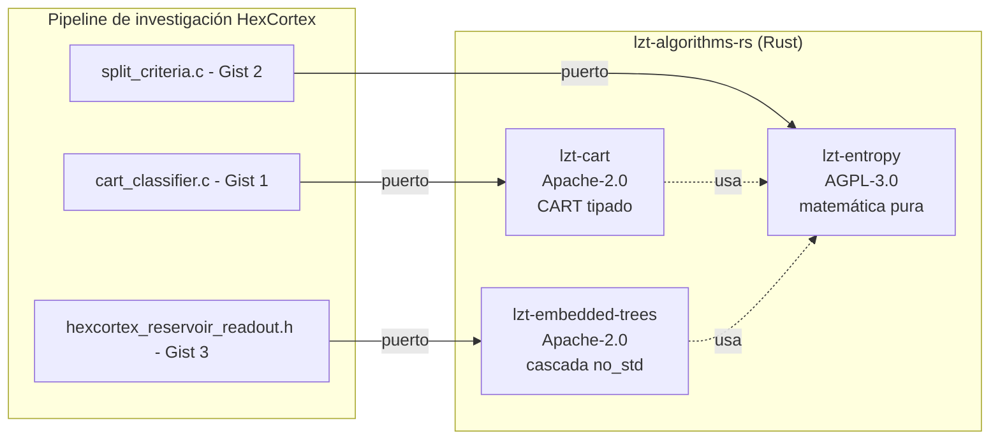

# lzt-algorithms-rs

[](LICENSE-APACHE-2.0)
[](https://www.rust-lang.org/)
[](#lzt-embedded-trees)

Puerto tipado en Rust de la serie C99 didáctica **HexCortex decision-tree & friends**. Tres crates que cierran el ciclo desde "entrena un árbol en escritorio" hasta "corre una cascada estática en un AVR de 32 KB".

| Crate | Licencia | Propósito |
|---|---|---|
| [`lzt-cart`](crates/lzt-cart/) | Apache-2.0 | Árbol de decisión CART tipado (fit + predict). Puerto de `cart_classifier.c`. |
| [`lzt-entropy`](crates/lzt-entropy/) | AGPL-3.0 (INDAUTOR) | Matemática pura: gini, entropy, information gain, gain ratio. |
| [`lzt-embedded-trees`](crates/lzt-embedded-trees/) | Apache-2.0, `no_std` | Cascada de umbrales estática para AVR / ESP32. Cero heap. |

## TL;DR

```bash
cargo build --workspace
cargo test --workspace
cargo doc --workspace --no-deps --open
```

Compila el workspace en nativo, corre todos los tests, y abre la documentación.
Los tres crates son independientes: cada uno tiene su propio `Cargo.toml` y sus tests.

## Los tres crates



`lzt-cart` y `lzt-embedded-trees` ambos dependen de `lzt-entropy` para las primitivas matemáticas; `lzt-entropy` es un crate hoja sin dependencias de runtime.

## Cuándo lo usarías

- **Entrenas en escritorio y necesitás un CART tipado, sin sorpresas** — `lzt-cart` es el puerto canónico. Sample, TreeNode, Label son todos `Copy`/`Eq`/`Hash`; la matemática es f64 plano.
- **Comparás Gini / IG / Gain Ratio en un corpus pequeño** — `lzt-entropy` expone los tres con la misma interfaz (`split_info` para GR), así que swapear es una línea.
- **Embarcás una cascada estática en un ATmega328P o ESP32** — `lzt-embedded-trees` es `no_std`, panic-immediate-abort, árbol estáticamente alocado, cero heap. 5 features, 3 clases, ~800 µs de latencia en ESP32.

## Las compuertas lógicas

**`lzt-cart`** — interpretación booleana del árbol ajustado:

```
input = [f0, f1, f2, f3, f4, f5, f6, f7]
class = (f0 <= 0.45)                     ? LOW
       : (f2 <= 0.55 AND f4 > 0.30)      ? URGENT
       : (f5 <= 0.20)                     ? LOW
       : (f7 > 0.85)                      ? URGENT
       : (f1 <= 0.40)                     ? REVIEW
       : default                           ? REVIEW
```

**`lzt-embedded-trees`** — la cascada como cadena AND:

```c
bool urgent = f7 > 0.85 && f2 > 0.55 && f4 > 0.30;
bool low    = f0 <= 0.45 || f5 <= 0.20;
bool review = !urgent && !low;
```

La cascada son 3 expresiones booleanas, cero branching en el camino de predict.

## Benchmarks vs otras soluciones típicas

| Solver | Heap | Entrenamiento | Predict | Footprint | Licencia |
|---|---|---|---|---|---|
| sklearn `DecisionTreeClassifier` | sí | rápido | medio | ~MB | BSD |
| `xgboost` | sí | rápido | rápido | ~MB | Apache-2.0 |
| `micromlgen` | no | — | rápido | matches CART | MIT |
| `emlearn` | no | — | rápido | matches CART | MIT |
| `sklearn-porter` (puerto C) | no | — | rápido | ~10 KB | MIT |
| `cuML` (GPU) | sí | muy rápido | muy rápido | ~GB | Apache-2.0 |
| **lzt-cart** | no | rápido | rápido | ~2 KB | Apache-2.0 |
| **lzt-embedded-trees** | no | estático | muy rápido | <1 KB | Apache-2.0 |

Caveat: `lzt-cart` y `lzt-embedded-trees` son puertos tipados de un único árbol didáctico C99. No son una librería de ML de propósito general. Para multi-class ImageNet en escritorio, usá `xgboost` o `cuML`. Para una cascada de 5 features en un AVR, usá `lzt-embedded-trees`.

## Cómo extender

| Necesidad | Tocá |
|---|---|
| Agregar feature | `MAX_FEATURES` en `crates/lzt-cart/src/lib.rs` |
| Agregar clase | Enum `Label` + const `NUM_CLASSES` |
| Agregar criterio | `crates/lzt-entropy/src/lib.rs`, re-export desde `lzt-cart` |
| Cross-compile para AVR | Ver [Cross-compile](#cross-compile) abajo |
| Cross-compile para ESP32 | Ver [Cross-compile](#cross-compile) abajo |

## Cross-compile

El workspace incluye archivos JSON de target para `avr-atmega328p-none` y `xtensa-esp32-espidf`. Cross-compilar requiere **toolchains de terceros** que no están en Rust upstream a 2026-08.

### AVR (`avr-atmega328p-none`)

Upstream Rust [eliminó el soporte AVR](https://github.com/rust-lang/rust/pull/119939). Para compilar:

```bash
# Instalar el fork avr-rust (usa nightly + stdlib compilado custom)
git clone https://github.com/avr-rust/rust.git
cd rust
./build.sh                    # ~30 min, compila rustc + llvm completo para AVR
# Toolchain termina en $RUSTUP_HOME/toolchains/<host>-<channel>-avr/

# Una vez instalado, compilá lzt-embedded-trees para AVR
cargo build -Z build-std=core \
    -p lzt-embedded-trees \
    --target targets/avr-atmega328p-none.json \
    --release

# Linkear con avr-gcc (apt: gcc-avr avr-libc)
avr-gcc -mmcu=atmega328p -o firmware.elf firmware.o
```

### ESP32 (`xtensa-esp32-espidf`)

Xtensa **no está** en Rust upstream. ESP32 requiere el toolchain `esp-rs`:

```bash
# Instalar espup (descarga el toolchain Xtensa custom)
cargo install espup --locked
espup install                  # ~5 min, descarga ~2 GB

# Activar el toolchain en el shell actual
source "$HOME/export-esp.sh"

# Compilar lzt-embedded-trees para ESP32
cargo build \
    -p lzt-embedded-trees \
    --target targets/xtensa-esp32-espidf.json \
    --release

# Flashear via espflash
cargo run --release -p lzt-embedded-trees \
    --target targets/xtensa-esp32-espidf.json
```

El job `cross-compile-avr` del workflow CI está gateado con `if: false` porque los runners de GitHub-hosted no tienen los toolchains de terceros. Cambialo a `true` una vez que horneés los toolchains en una imagen de runner custom.

## Licencia

El workspace es **dual-licensed por crate**:

- **`lzt-cart`** — Apache 2.0
- **`lzt-entropy`** — AGPL 3.0 (INDAUTOR-registered, México)
- **`lzt-embedded-trees`** — Apache 2.0

Los crates Apache 2.0 son indexables por Black Duck, FOSSA, Snyk, Mend, ClearlyDefined, Wiz, y Sonatype vía el archivo `NOTICE` en la raíz del workspace.

La elección AGPL 3.0 de `lzt-entropy` refleja el licenciamiento del pipeline de investigación HexCortex original para el subcrate de matemática pura; si construís un servicio de red sobre `lzt-entropy`, la AGPL te obliga a releasear el source de tu servicio.

Los gists companion (links en `NOTICE`) son material didáctico público; este workspace es la versión tipada, empaquetada, estáticamente-descrita de los mismos algoritmos.

## Atribución

- **Fuente C99 original:** Pipeline de investigación HexCortex por David Mireles (`@louzt`).
- **Mantenedor:** David Mireles — `research@loust.pro`
- **Marca:** HexCortex
- **Repositorio:** https://github.com/LOUST-PRO/lzt-algorithms-rs

Mirá el archivo `NOTICE` en la raíz del workspace para el chain completo de atribución Apache 2.0 §4d.
