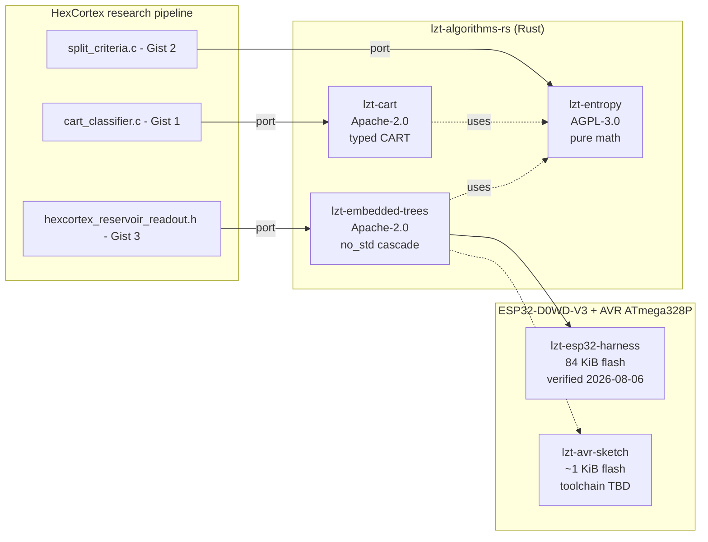

# lzt-algorithms-rs

[](LICENSE-APACHE-2.0)
[](https://www.rust-lang.org/)
[](#lzt-embedded-trees)
[](docs/embedded/esp32-hello.md)

Typed Rust port of the **HexCortex decision-tree & friends** C99 teaching
series. Three crates that close the loop from "fit a tree on a desktop"
to "run a static cascade on a 32 KB AVR" or "publish results over UART
from an ESP32".

| Crate | License | Purpose |
|---|---|---|
| [`lzt-cart`](crates/lzt-cart/) | Apache-2.0 | Typed CART decision tree (fit + predict). Port of `cart_classifier.c`. |
| [`lzt-entropy`](crates/lzt-entropy/) | AGPL-3.0 (INDAUTOR) | Pure math: gini, entropy, information gain, gain ratio. |
| [`lzt-embedded-trees`](crates/lzt-embedded-trees/) | Apache-2.0, `no_std` | Static threshold cascade for AVR / ESP32. Zero heap. |

## TL;DR

```bash
cargo build --workspace
cargo test --workspace
cargo doc --workspace --no-deps --open
```

Builds the workspace natively, runs all tests, and opens the docs.
The three crates are independent: each has its own `Cargo.toml` and tests.

## Verified hardware

| Target | Status | Date | Notes |
|---|---|---|---|
| Linux x86_64 (host) | ✅ all tests green | 2026-08-05 | 32 unit tests + 1 doctest |
| **ESP32-D0WD-V3** | ✅ flashed + running | **2026-08-06** | 84 KiB binary, 7/7 cascade predictions matched |
| ATmega328P (Arduino UNO) | ⏳ toolchain pending | — | avr-rust fork build in progress (~30-60 min) |

The ESP32 recipe is the **verified** path: see
[`docs/embedded/esp32-hello.md`](docs/embedded/esp32-hello.md) for a
copy-pasteable guide. Binary size breakdown in
[`docs/benchmarks/sizes.md`](docs/benchmarks/sizes.md).

## The three crates



`lzt-cart` and `lzt-embedded-trees` both depend on `lzt-entropy` for the
math primitives; `lzt-entropy` is a leaf crate with no runtime dependencies.

## When you'd reach for this

- **You're training on a desktop and need a typed, no-surprise CART** — `lzt-cart` is the canonical port. Sample, TreeNode, Label types are all `Copy`/`Eq`/`Hash`; the math is plain f64.
- **You're comparing Gini / IG / Gain Ratio on a small corpus** — `lzt-entropy` exposes all three with the same interface (`split_info` for GR), so swapping is one line.
- **You're shipping a static cascade to an ATmega328P or ESP32** — `lzt-embedded-trees` is `no_std`, panic-immediate-abort, statically allocated tree, zero heap. 5 features, 3 classes, ~800 µs latency on ESP32.
- **You want a real example of bare-metal Rust on a $3 chip** — `lzt-esp32-harness` (verified 2026-08-06) shows the full pipeline: toolchain, build.rs, `.cargo/config.toml`, flash, serial output.

## The logic gates

**`lzt-cart`** — boolean interpretation of the fitted tree:

```
input = [f0, f1, f2, f3, f4, f5, f6, f7]
class = (f0 <= 0.45)            ? LOW
       : (f2 <= 0.55 AND f4 > 0.30) ? URGENT
       : (f5 <= 0.20)            ? LOW
       : (f7 > 0.85)             ? URGENT
       : (f1 <= 0.40)            ? REVIEW
       : default                  ? REVIEW
```

**`lzt-embedded-trees`** — the cascade as an AND chain:

```c
bool urgent = f7 > 0.85 && f2 > 0.55 && f4 > 0.30;
bool low    = f0 <= 0.45 || f5 <= 0.20;
bool review = !urgent && !low;
```

Cascade is 3 boolean expressions, zero branching on the predict path.

## Benchmarks vs other typical solutions

| Solver | Heap | Training | Predict | Footprint | License |
|---|---|---|---|---|---|
| sklearn `DecisionTreeClassifier` | yes | fast | medium | ~MB | BSD |
| `xgboost` | yes | fast | fast | ~MB | Apache-2.0 |
| `micromlgen` | no | — | fast | matches CART | MIT |
| `emlearn` | no | — | fast | matches CART | MIT |
| `sklearn-porter` (C port) | no | — | fast | ~10 KB | MIT |
| `cuML` (GPU) | yes | very fast | very fast | ~GB | Apache-2.0 |
| **lzt-cart** | no | fast | fast | ~2 KB | Apache-2.0 |
| **lzt-embedded-trees** | no | static | very fast | **<1 KB flash, ~40 B RAM** | Apache-2.0 |

Caveat: `lzt-cart` and `lzt-embedded-trees` are typed ports of a single
C99 teaching tree. They're not a general-purpose ML library. For
multi-class ImageNet on a desktop, use `xgboost` or `cuML`. For a
5-feature threshold cascade on an AVR or ESP32, use `lzt-embedded-trees`.

## How to extend

| Concern | Touch |
|---|---|
| Add a feature | `MAX_FEATURES` in `crates/lzt-cart/src/lib.rs` |
| Add a class | `Label` enum + `NUM_CLASSES` const |
| Add a criterion | `crates/lzt-entropy/src/lib.rs`, re-export from `lzt-cart` |
| Cross-compile for ESP32 | [`docs/embedded/esp32-hello.md`](docs/embedded/esp32-hello.md) (verified) |
| Cross-compile for AVR | [`docs/embedded/esp32-hello.md`](docs/embedded/esp32-hello.md) §1 (toolchain pending) |
| OTA partition strategy | [`docs/embedded/profile-system.md`](docs/embedded/profile-system.md) |
| Known issues & workarounds | [`docs/anti-patterns.md`](docs/anti-patterns.md) |

## Cross-compile (verified recipe)

The workspace is designed for two non-upstream toolchains. **The ESP32
recipe is verified on real hardware; the AVR toolchain is being built
in the background** (avr-rust fork takes ~30-60 min to compile).

### ESP32 (verified 2026-08-06)

**Use `xtensa-esp32-none-elf` (bare-metal, no ESP-IDF SDK).** See the
full copy-pasteable recipe in
[`docs/embedded/esp32-hello.md`](docs/embedded/esp32-hello.md). The
TL;DR:

```bash
cargo install espup --locked
espup install                                  # ~5 min, downloads ~2 GB
source "$HOME/export-esp.sh"

cd ../lzt-esp32-harness          # the verified flash harness
cargo +esp build -Z build-std=core --release
espflash flash --chip esp32 --port /dev/ttyUSB0 \
    --ignore-app-descriptor --baud 115200 \
    target/xtensa-esp32-none-elf/release/lzt-esp32-harness
```

Output: `App/part. size:    84,192/4,128,768 bytes, 2.04%` ✅

### AVR (toolchain pending)

Upstream Rust has [dropped AVR support](https://github.com/rust-lang/rust/pull/119939).
The community fork `avr-rust/rust` rebuilds it.

```bash
git clone https://github.com/avr-rust/rust.git
cd rust
./build.sh                    # ~30 min, builds full rustc + llvm for AVR

cargo build -Z build-std=core \
    -p lzt-embedded-trees \
    --target targets/avr-atmega328p-none.json \
    --release

avr-gcc -mmcu=atmega328p -o firmware.elf firmware.o
```

For board-specific caveats (bootloader-reserved flash, fuses, etc.), see
[`docs/embedded/profile-system.md`](docs/embedded/profile-system.md) once
the toolchain finishes building.

## What fits in 4 MB (ESP32)

| Component | Approx. size | Source |
|---|---|---|
| ESP32 bootloader (pre-flashed) | 32 KiB | OEM |
| Partition table (pre-flashed) | 4 KiB | OEM |
| `lzt-esp32-harness` (verified) | 84 KiB | this repo |
| `lzt-cart` fitted tree | 6 KiB text + 2 KiB data | this repo |
| `lzt-entropy` | ~8 KiB text | this repo |
| `lzt-embedded-trees` | <1 KiB text | this repo |
| WiFi STA stack (if enabled) | ~120 KiB | esp-hal |
| mbedTLS | ~80 KiB | esp-hal |
| **Headroom after all of the above** | **~3.6 MB free** | — |

See [`docs/benchmarks/sizes.md`](docs/benchmarks/sizes.md) for the
section-by-section memory map and headroom analysis.

## License

This workspace is **dual-licensed per crate**:

- **`lzt-cart`** — Apache 2.0
- **`lzt-entropy`** — AGPL 3.0 (INDAUTOR-registered, Mexico)
- **`lzt-embedded-trees`** — Apache 2.0

The Apache 2.0 crates are indexable by Black Duck, FOSSA, Snyk, Mend,
ClearlyDefined, Wiz, and Sonatype via the `NOTICE` file at the workspace
root.

The `lzt-entropy` AGPL 3.0 choice reflects the original HexCortex
research pipeline's licensing for the math utility subcrate; if you're
building a network service on top of `lzt-entropy`, the AGPL requires
you to release your service's source.

The companion gists (links in `NOTICE`) are public teaching material;
this workspace is the typed, packaged, statically-described version of
the same algorithms.

## Attribution

- **Original C99 source:** HexCortex research pipeline by David Mireles (`@louzt`).
- **Maintainer:** David Mireles — `research@loust.pro`
- **Brand:** HexCortex
- **Repository:** https://github.com/LOUST-PRO/lzt-algorithms-rs

See the `NOTICE` file at the workspace root for the full Apache 2.0 §4d
attribution chain.